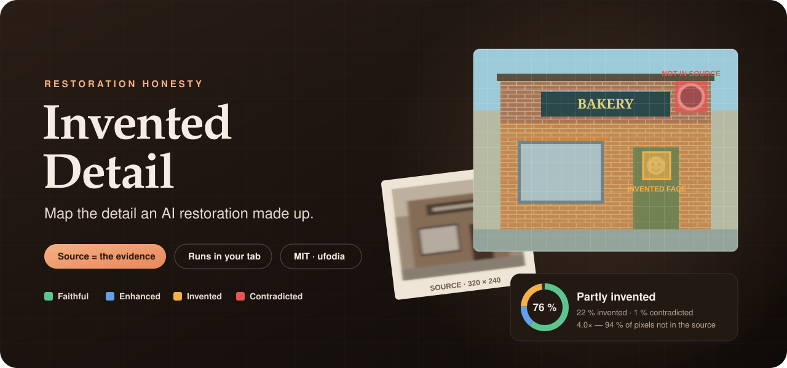
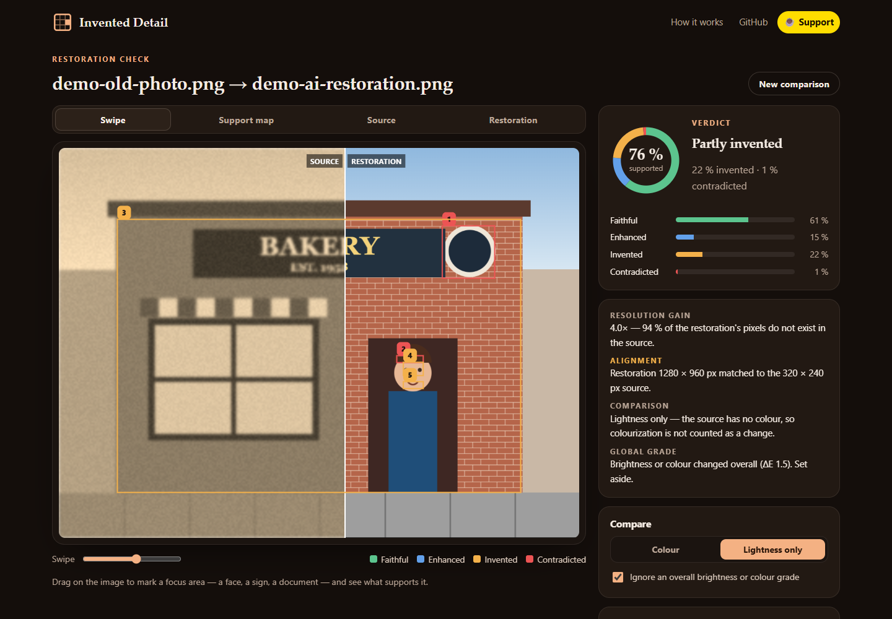
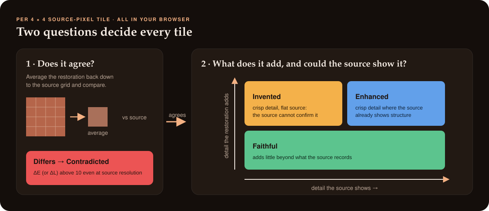
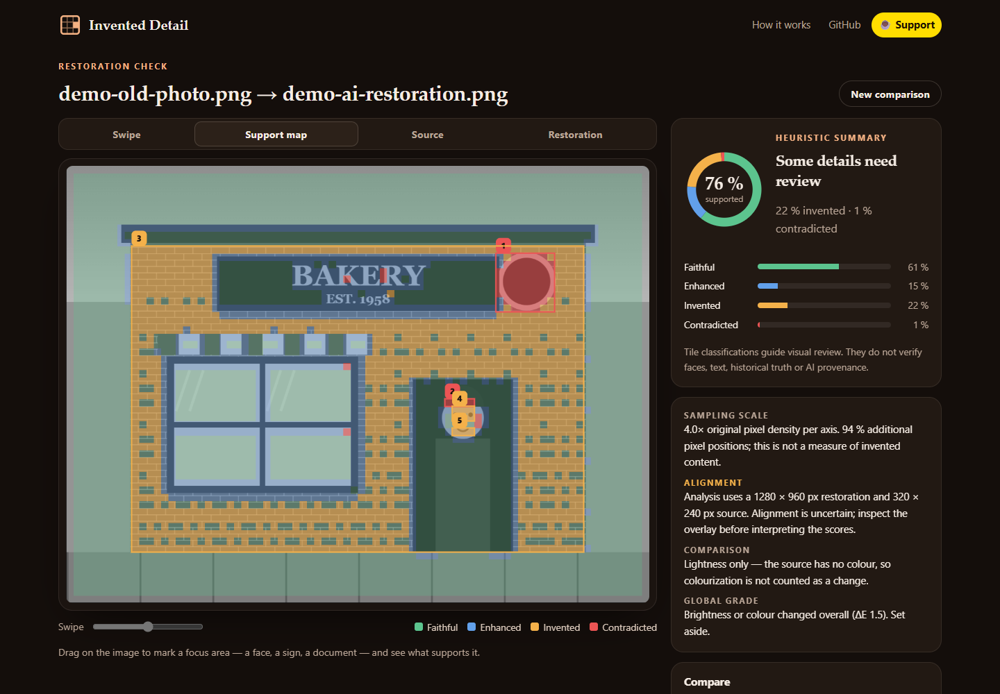
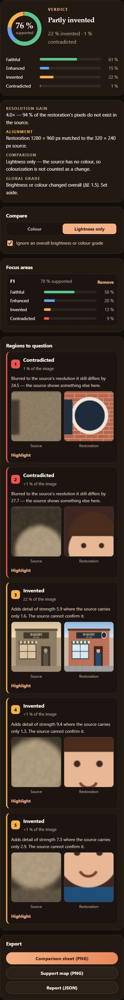
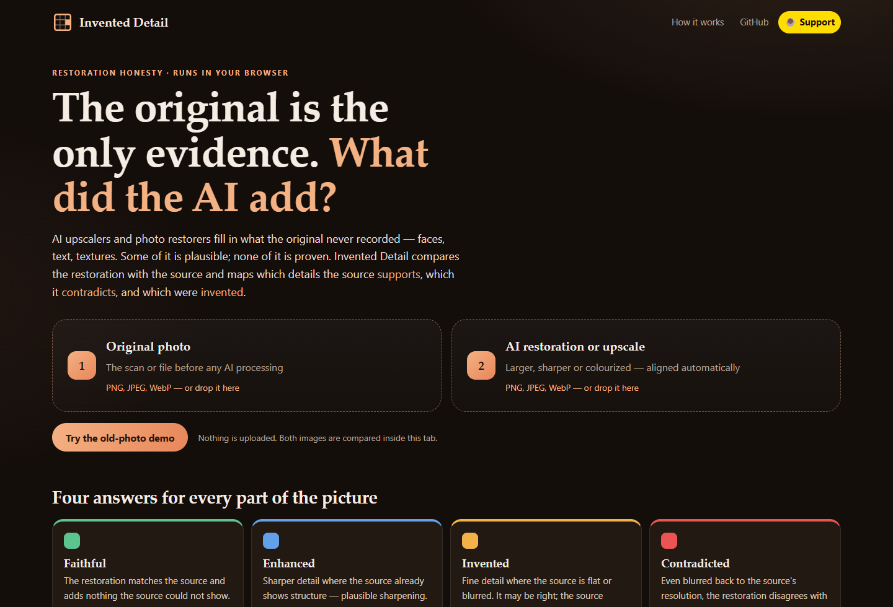
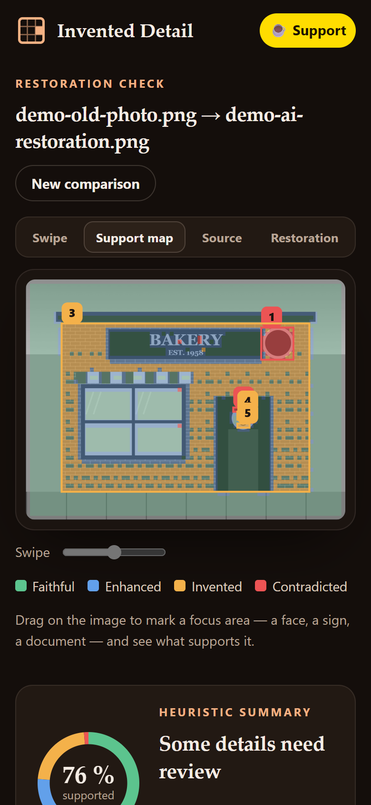

<p align="center">
  
</p>

<h3 align="center">A sharper photo deserves a closer look.</h3>
<p align="center">Compare an original with its restoration. Inspect consistency, added detail and the areas worth questioning — entirely in your browser.</p>

<p align="center">
  <a href="https://invented-detail.vercel.app/"><b>Live demo ↗</b></a> ·
  <a href="#quick-start"><b>Quick start</b></a> ·
  <a href="#the-four-answers">The four answers</a> ·
  <a href="#how-it-works">How it works</a> ·
  <a href="#a-tour-of-the-app">Tour</a> ·
  <a href="#faq">FAQ</a> ·
  <a href="https://buymeacoffee.com/ufodia">Support ☕</a>
</p>

<p align="center">
  
  
  
  
  
</p>

---

## The problem

AI upscalers and photo restorers are astonishing. Feed them a blurry 320-pixel scan of a family photo and they return a crisp 4K portrait — skin pores, eyelashes, brick mortar, the lettering on a shop sign.

An enlargement creates more pixel positions; it does not establish what was originally in the scene. A 4× enlargement has 16× as many pixels even when produced by ordinary interpolation. The question is which visible changes deserve a closer look. That matters when:

- a genealogist wonders whether a restored face is really great-grandmother's,
- a journalist or archivist publishes an "enhanced" historical photo,
- an investigator reads a licence plate or a sign off an upscaled frame,
- anyone shares a restoration as if it were a better copy of the original.

## The answer

**Invented Detail** compares the result with the original using classic image processing. Its four tile labels summarize **consistency**, **sharpening**, **added detail on a low-detail source**, and **disagreement**. The map guides visual review; it is not an authenticity detector or a calibrated confidence score.

<p align="center">
  
  <br><sub>The synthetic demo. The restoration added brick mortar and a face that the photo cannot show, read the sign as “1958”, and painted a round window that the photo clearly does not have.</sub>
</p>

## Who it is for

| You… | Invented Detail helps you… |
| --- | --- |
| **restore family photos** | compare changes before framing or sharing a restoration |
| **work in an archive, museum or newsroom** | document a restoration with the original, a review map and reproducible settings |
| **investigate images** | locate differences for human review while treating apparent text and faces as unverified |
| **build or compare upscalers** | compare fixed image-analysis heuristics on your own test images, region by region |
| **teach media literacy** | show students, visually, why “enhance!” cannot recover what was never recorded |

## Quick start

> **Requirements:** Node.js 24 and npm. No account, API key, model or GPU.

```bash
git clone https://github.com/ufodia/invented-detail.git
cd invented-detail
npm ci
npx playwright install chromium  # only needed for browser tests/screenshots
npm run dev
```

Open the printed `http://127.0.0.1:5173` address, then drop the **original photo** into slot 1 and the **AI restoration** into slot 2 — or click **Try the old-photo demo**. Drag on the image to mark a **focus area** such as a face or a sign and see what supports it.

## The four answers

| | Answer | Meaning | Typical example |
| --- | --- | --- | --- |
| 🟩 | **Faithful** | low difference and little added detail at the analysis resolution | sky, plain walls, out-of-focus backgrounds |
| 🟦 | **Enhanced** | sharper detail where the source already shows structure | crisper window frames, cleaner edges |
| 🟨 | **Invented** | fine detail where the source is flat or blurred — it may be right, but the source cannot say | faces from a blur, brick mortar, fabric weave, lettering |
| 🟥 | **Contradicted** | even blurred back down to the source's resolution, the restoration disagrees with the source | an added window, a moved object, changed shapes |

The **support score** is faithful + enhanced among classified tiles. It is a descriptive heuristic, **not the probability that the image is true**. *Invented* flags fine detail on a low-detail source region; *faithful* can still contain incorrect words or facial features. Borders and uncovered areas are excluded. All measurements use a bounded analysis image, so detail removed by downsampling is outside the method's view.

## How it works

<p align="center">
  
</p>

1. **Align.** The restoration is shrunk to the source's analysis size and aligned with a coarse-to-fine scale and offset search on gradients. This reduces sensitivity to colourization and grading; it does not make alignment infallible.
2. **Build a comparison frame.** The source grid enlarged by the resolution gain (at most 1600 px), with the restoration resampled into it.
3. **Question 1 — does it agree?** The restoration is area-averaged back to the source's grid. A global grade is fitted and set aside. Where the averaged restoration still differs from the source by more than ΔE 10 (or ΔL 10), the tile is **contradicted**.
4. **Question 2 — what does it add?** The detail finer than the source grid is measured (the restoration minus its own band-limited version), and so is the detail the source itself shows. Added detail on a flat source is **invented**; on a structured source it is **enhanced**; little added detail is **faithful**.
5. **Group.** Tiles of 4 × 4 source pixels are classified, the border ring is excluded, and connected invented or contradicted tiles become numbered regions with before/after crops.

**Colourized black-and-white photos** are recognized automatically — including sepia and other toned prints — and compared on lightness only, so the added colour is not counted as a contradiction. You can switch to colour comparison at any time.

Read the full [method](docs/method.md), including what it cannot tell you.

## A tour of the app

<table>
  <tr>
    <td width="62%"></td>
    <td width="38%"></td>
  </tr>
  <tr>
    <td><b>Support map.</b> Every tile coloured by its answer. Numbered boxes mark the regions worth questioning.</td>
    <td><b>Results.</b> Support score, class shares, resolution gain, focus areas and region cards that put the source and the restoration side by side.</td>
  </tr>
  <tr>
    <td></td>
    <td align="center"></td>
  </tr>
  <tr>
    <td><b>Start.</b> Two slots and an explanation of the four answers.</td>
    <td><b>Phone-ready.</b> The full workflow fits a 390 px screen.</td>
  </tr>
</table>

### Focus areas

Drag a box over anything you care about — a face, a name on a sign, a licence plate. Each focus area gets its own composition, so you can say: *“the face is 13 % invented and 9 % contradicted; the rest of the photo is 76 % supported.”*

## Exports

| File | Contents |
| --- | --- |
| `invented-detail-comparison.png` | the source (enlarged) and the restoration side by side with the same numbered regions, plus a summary footer — good for captions and archives |
| `invented-detail-map.png` | the support map with regions and a legend |
| `invented-detail-report.json` | original-file sampling scale, additional pixel-position share, analysis dimensions, support score, settings, alignment, grade, region and focus-area boxes in frame **and original restoration** pixels |

<details>
<summary><b>Example: an excerpt of the JSON report for the demo</b></summary>

```json
{
  "tool": { "name": "Invented Detail", "version": "1.0.0" },
  "settings": { "mode": "lightness", "compensateTone": true },
  "resolutionGain": 4.003,
  "additionalPixelShare": 0.9376,
  "supportScore": 0.763,
  "shares": { "faithful": 0.6094, "enhanced": 0.1536, "invented": 0.2226, "contradicted": 0.0144 },
  "regions": [
    { "id": 1, "kind": "contradicted", "shareOfImage": 0.0119, "consistency": 24.5, "addedDetail": 5.72, "sourceDetail": 2.34 },
    { "id": 3, "kind": "invented", "shareOfImage": 0.2206, "consistency": 1.26, "addedDetail": 5.88, "sourceDetail": 1.64 }
  ]
}
```

</details>

`resolutionGain` corrects for both internal image-size limits. `additionalPixelShare = max(0, 1 − 1/resolutionGain²)` describes sampling density only; it does **not** measure how much content an AI model invented. Report alignment values use the explicitly recorded analysis coordinate system; `boxInOutput` uses the original restoration dimensions.

PNG exports show the bounded comparison frame, not a newly restored original. Small frames are enlarged for readable captions and a complete legend.

## Privacy

Both images are decoded in your browser and compared in a Web Worker. The production configuration sends `Content-Security-Policy: connect-src 'none'`, blocking scripted connections such as fetch, XHR and WebSocket. Photos are never uploaded or persisted by the app. The host still serves static app assets and may keep ordinary access logs; following GitHub or support links opens an external service. There are no runtime dependencies, analytics, remote fonts or CDNs in the app. See [docs/privacy.md](docs/privacy.md).

## Honest limitations

- **Heuristics are not proof.** Labels are fixed-threshold image measurements, not a forensic validation or a provenance verdict. Both false positives and missed changes are possible.
- **Plausible text and digits.** When a source is blurred but not featureless (like the “1952” on the demo sign), the restoration's specific characters can land in *enhanced*: the source shows *that* there is lettering, not *which* letters. Use focus areas and the crops, and treat small text in any restoration as unverified.
- **Geometry.** Only scale, crop and offset are aligned. Restorations that warp, rotate or re-frame the picture will look contradicted.
- **Source quality.** JPEG blocks, scratches and scanner noise in the source are evidence too; a restoration that removes them can appear contradicted where the damage was strong.

## FAQ

<details>
<summary><b>Can it tell me whether a restored face is correct?</b></summary>

No. The map may flag added detail or disagreement, but it cannot establish a person's identity, prove which features a model generated, or verify a restored face. Use independent evidence and human review.
</details>

<details>
<summary><b>Does it detect AI-generated images?</b></summary>

No. It needs the original and the restoration, and measures how much of one the other supports.
</details>

<details>
<summary><b>What about colourized photos?</b></summary>

Monochrome and toned sources are detected automatically and compared on lightness. Colour itself is always invented in a colourization — the source simply has none — and the app says so.
</details>

<details>
<summary><b>How big can the images be?</b></summary>

Files up to 80 MiB are accepted. The source is downsampled to at most 1024 px on its longer side, the restoration to at most 4096 px, and the comparison frame to at most 1600 px. Each loaded canvas must remain at least 32 px on both sides. Very large decoded originals can still exceed a browser's memory limits; the app does not replace the original files or export a full-resolution restoration.
</details>

## Documentation

| Guide | What's inside |
| --- | --- |
| [User guide](docs/user-guide.md) | loading, views, focus areas, settings, exports and troubleshooting |
| [Method](docs/method.md) | alignment, frame, consistency, added detail, thresholds and limitations |
| [Architecture](docs/architecture.md) | modules, worker protocol and report format |
| [Privacy](docs/privacy.md) · [Deployment](docs/deployment.md) | what runs where, self-hosting with security headers, and recovery from a clean clone |
| [Changelog](CHANGELOG.md) | release notes |

## Development

```bash
npm run dev            # local development server
npm run check          # strict typecheck, unit tests and a production build
npm run test:browser   # Playwright workflows in Chromium, isolated port 4174
npm run format:check   # Prettier
npm run screenshots    # regenerate README screenshots from the demo
```

The analysis is pure TypeScript on typed arrays and is unit-tested in Node with procedurally rendered scenes: plain enlargements, mean-preserving invented texture, contradicting colour changes, global grades, colourized greyscale, sepia detection and large outputs. See [CONTRIBUTING.md](CONTRIBUTING.md).

## Support

Invented Detail is free and has no ads. If it helped you caption a restoration honestly, a coffee keeps it maintained.

<p align="center">
  <a href="https://buymeacoffee.com/ufodia"></a>
</p>

## License

[MIT](LICENSE) © 2026 [ufodia](https://github.com/ufodia)

Created and maintained by **ufodia**, the sole current contributor. The procedural demo and first-party artwork are included under the same license; see [third-party notices](THIRD_PARTY_NOTICES.md).
